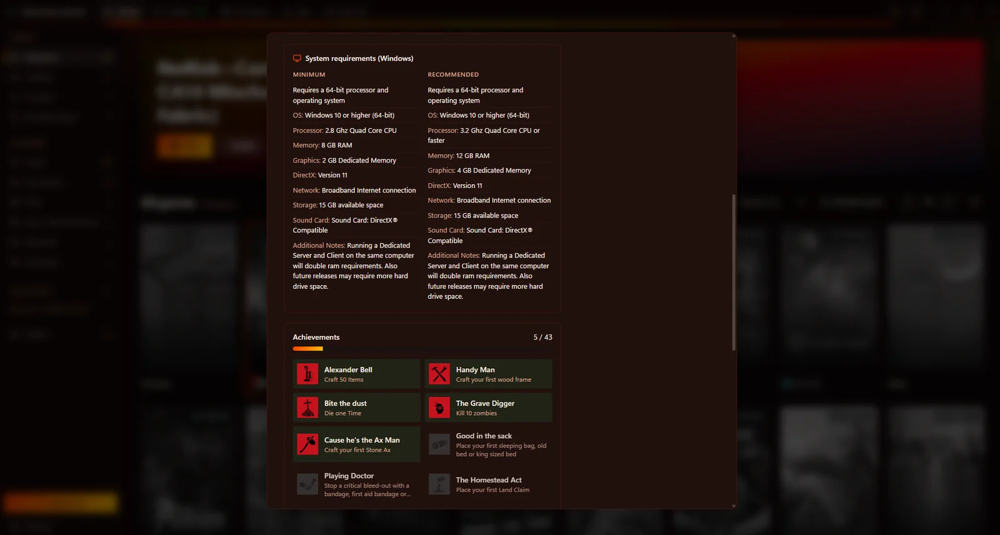
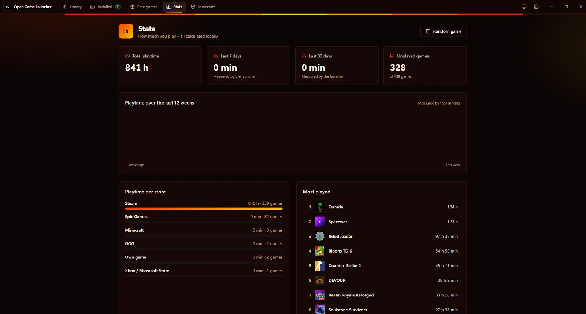
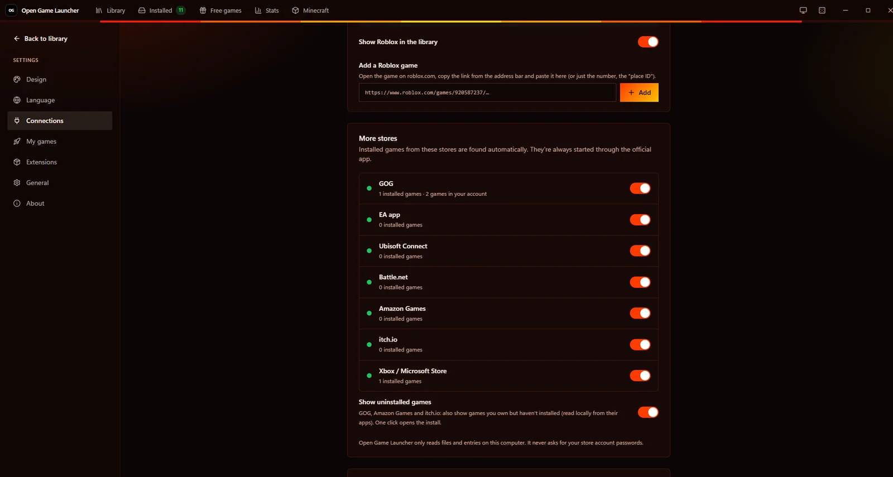
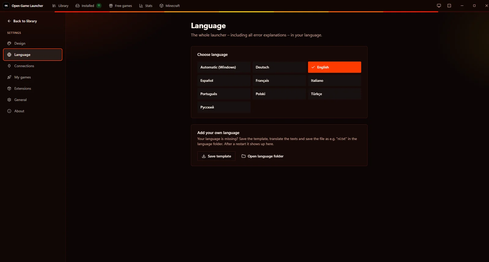

<div align="center">


# Open Game Launcher

**Alle deine Spiele. Ein Launcher.** · kurz OG · früher *MAZ Launcher*

Steam, Epic Games, Roblox und deine eigenen Spiele in einer schnellen, schlanken und schönen App für **Windows, macOS und Linux**, geschrieben zu 100 % in Rust. Alles läuft lokal – kein Konto.

[](https://github.com/MikeAdamRGB/Open-Game-Launcher/releases/latest)
[](https://github.com/MikeAdamRGB/Open-Game-Launcher/releases)
[](https://github.com/MikeAdamRGB/Open-Game-Launcher/actions/workflows/build.yml)


[](../../LICENSE)

[English](../../README.md) · **Deutsch** · [Français](README.fr.md) · [Español](README.es.md) · [Italiano](README.it.md) · [Português](README.pt-BR.md) · [Polski](README.pl.md) · [Türkçe](README.tr.md) · [Русский](README.ru.md) · [日本語](README.ja.md) · [한국어](README.ko.md) · [简体中文](README.zh-CN.md)

[**⬇️ Herunterladen**](https://github.com/MikeAdamRGB/Open-Game-Launcher/releases/latest) · [**🌐 Webseite**](https://mikeadamrgb.github.io/Open-Game-Launcher/) · [**☕ Trinkgeld auf Ko-fi**](https://ko-fi.com/mikeadamrgb)

<br>


</div>

---

## Inhalt

- [Funktionen](#funktionen)
- [Screenshots](#screenshots)
- [Installation](#installation)
- [Benutzung](#benutzung)
- [Selbst bauen](#selbst-bauen)
- [Technik](#technik)
- [FAQ](#faq)
- [Mitmachen](#mitmachen)
- [Lizenz](#lizenz)

## Funktionen

| | |
|---|---|
| 🎮 **Eine Bibliothek für alles** | Steam, Epic Games, GOG, EA app, Ubisoft Connect, Battle.net, Amazon Games, itch.io, Xbox / Microsoft Store, Roblox, Minecraft & NoRisk Client, Emulatoren und eigene Spiele. Installierte Spiele **und** die ganze Bibliothek, soweit der Store sie lokal speichert. Gestartet wird immer über das offizielle Programm. |
| 🗂️ **Ordnung** | Suche, Sortierung und Filter, Tags, Sammlungen, **Spielstatus** (nicht begonnen, spiele ich, durchgespielt, abgebrochen), doppelte Spiele zu einer Kachel zusammengefasst. Import von Tags, Spielzeit und mehr aus **Playnite**. |
| 📊 **Statistik & Ideen** | Spielzeit pro Woche, Monat und Store, meistgespielte und ungespielte Spiele, ein **„Was soll ich spielen?“**-Knopf und ein HowLongToBeat-Link für jedes Spiel. |
| 📝 **Spiel-Infos** | Beschreibung, Genres, PC-Anforderungen und Steam-Deck-Bewertung – aus dem Steam-Store und von Wikipedia. Alles selbst bearbeitbar. |
| ⛏️ **Minecraft-Mods** | Mods, Texturenpakete, Shader und Datenpakete von Modrinth und CurseForge mit einem Klick installieren – in den offiziellen Launcher oder ein NoRisk-Profil. Schon Installiertes wird angezeigt. |
| 🎨 **Dein Look** | Steam-, Epic- oder OG-Ansicht, 20 Designs plus eigene, Hintergrundbild, Controller-Modus und 9 Sprachen. |
| 🛟 **Hilfe bei Fehlern** | Startet ein Spiel nicht, erklärt der Launcher Schritt für Schritt, was los ist – mit Knöpfen, die es direkt beheben. |
| 🔒 **Lokal und sicher** | Kein Konto, kein Tracking. Updates in der App (mit Prüfsumme), Sicherung aller Einstellungen als eine Datei, Erweiterungen nur auf Wunsch. |
| 🐧 **Jede Plattform** | Windows (x86_64, ARM64), macOS (Apple Silicon + Intel), Linux (x86_64, ARM64) als AppImage, .deb, .rpm, Pacman, Flatpak und Snap – mit Wine/Proton pro Spiel. |

Alle Änderungen je Version: [CHANGELOG.md](../../CHANGELOG.md).

## Screenshots

<table>
  <tr>
    <td width="50%" align="center">
      <br>
      <sub><b>Bibliothek</b>: alle Spiele aus allen Stores an einem Ort</sub>
    </td>
    <td width="50%" align="center">
      <br>
      <sub><b>Spiel-Details</b>: Trailer, Installieren, Favorit, Starthilfen, HowLongToBeat</sub>
    </td>
  </tr>
  <tr>
    <td width="50%" align="center">
      <br>
      <sub><b>Anforderungen & Erfolge</b>: Läuft es bei mir, und wie weit bin ich?</sub>
    </td>
    <td width="50%" align="center">
      <br>
      <sub><b>Statistik</b>: Spielzeit pro Store und meistgespielt – lokal berechnet</sub>
    </td>
  </tr>
  <tr>
    <td width="50%" align="center">
      <br>
      <sub><b>Minecraft</b>: Mods, Ressourcenpakete und Shader mit einem Klick</sub>
    </td>
    <td width="50%" align="center">
      <br>
      <sub><b>Stores</b>: GOG, EA, Ubisoft, Battle.net, Amazon, itch.io, Xbox – automatisch gefunden</sub>
    </td>
  </tr>
  <tr>
    <td width="50%" align="center">
      <br>
      <sub><b>Designs</b>: 20 fertige Designs und eigene</sub>
    </td>
    <td width="50%" align="center">
      <br>
      <sub><b>9 Sprachen</b>: der ganze Launcher in deiner Sprache</sub>
    </td>
  </tr>
</table>

## Installation

Alle Dateien gibt es unter [**Releases**](https://github.com/MikeAdamRGB/Open-Game-Launcher/releases/latest). In `SHA256SUMS.txt` steht zu jeder Datei eine Prüfsumme.

### Windows 10 / 11
1. **`Open-Game-Launcher.exe`** herunterladen (Windows auf ARM: **`Open-Game-Launcher-arm64.exe`**).
2. **Doppelklick** → **„Installieren“** → **„Jetzt öffnen“**.

> [!TIP]
> **„Der Computer wurde durch Windows geschützt“?** Das passiert bei neuen Programmen ohne bezahltes Zertifikat. Auf **„Weitere Informationen“** und dann **„Trotzdem ausführen“** klicken.

### macOS 11 oder neuer (Apple Silicon + Intel)
1. **`Open-Game-Launcher-…-macOS.dmg`** herunterladen, öffnen und **Open Game Launcher** in **„Programme“** ziehen.
2. Beim ersten Mal: **Rechtsklick** auf die App → **„Öffnen“** → **„Öffnen“**. macOS fragt einmal, weil die App nicht aus dem App Store kommt.

### Linux (x86_64 und ARM64)

| Distribution | Datei | Installieren |
|---|---|---|
| Alle | `Open-Game-Launcher-…-x86_64.AppImage` / `-aarch64.AppImage` | `chmod +x Open-Game-Launcher-*.AppImage` und starten |
| Ubuntu, Debian, Mint, Pop!_OS | `maz-launcher_…_amd64.deb` / `_arm64.deb` | `sudo apt install ./maz-launcher_*.deb` |
| Fedora, openSUSE, Nobara | `maz-launcher-…-1.x86_64.rpm` / `.aarch64.rpm` | `sudo dnf install ./maz-launcher-*.rpm` |
| Arch, Manjaro, EndeavourOS, CachyOS | `maz-launcher-…-x86_64.pkg.tar.zst` | `sudo pacman -U maz-launcher-*.pkg.tar.zst` |
| Alle (Sandbox) | `maz-launcher-…-x86_64.flatpak` | `flatpak install --user maz-launcher-*.flatpak` |
| Ubuntu & Snap | `maz-launcher_…_amd64.snap` | `sudo snap install --dangerous --classic maz-launcher_*.snap` |

Der Launcher nutzt **webkit2gtk-4.1** vom System (auf den meisten Desktops schon da). Epic-Spiele laufen über den [Heroic Games Launcher](https://heroicgameslauncher.com), Roblox über [Sober](https://flathub.org/apps/org.vinegarhq.Sober).

### Updates
Der Open Game Launcher schaut bei GitHub nach neuen Versionen (abschaltbar unter **Einstellungen → Allgemein**). **„Jetzt updaten“** lädt die passende Datei, prüft die Prüfsumme und installiert sie. Bei Linux-Paketen fragt er nach deinem Passwort und nutzt den Paketmanager. Neue Versionen erscheinen weiterhin auch auf GitHub.

## Benutzung

- **Spielen:** Mit der Maus über ein Spiel fahren und auf ▶ klicken. Ein Klick auf das Cover öffnet die Details.
- **Eigenes Spiel hinzufügen:** Links auf **„Spiel hinzufügen“** → bei „Programm“ auf **„Durchsuchen…“** → die Start-Datei des Spiels wählen → **„Hinzufügen“**.
- **Aussehen ändern:** **Einstellungen → Design** → Ansicht (OG / Steam / Epic) und Farbschema wählen.
- **Alle Epic-Spiele sehen:** oben in der Bibliothek beim Hinweis auf **Verbinden** klicken (oder **Einstellungen → Verbindungen → Epic-Konto verbinden**). Drei Schritte: im Browser bei Epic anmelden → auf der Seite, die Epic zeigt, Strg + A und Strg + C drücken (Mac: ⌘) → fertig. Ein Balken zeigt, wie viele Spiele schon geladen sind.
- **Genauere Steam-Liste (optional):** **Einstellungen → Verbindungen** → kostenlosen Steam-Web-API-Schlüssel eintragen. Die Anleitung steht direkt daneben.
- **Spiel deinstallieren:** Spiel öffnen → **Deinstallieren**.
- **Spiel startet nicht?** Spiel öffnen → **Startet nicht? Hilfe**. Stürzt ein Spiel direkt nach dem Start ab, erscheint die Erklärung automatisch.
- **Roblox:** **Einstellungen → Verbindungen → Roblox** → Link eines Roblox-Spiels einfügen (z. B. `https://www.roblox.com/games/920587237/…`).
- **Ordner durchsuchen:** leere Bibliothek oder **Meine Spiele** → **Ordner durchsuchen** → z. B. `D:\Spiele` wählen → Spiele anhaken → **Hinzufügen**.
- **Tags & Sammlungen:** Spiel öffnen → unten einen Tag eintippen oder eine Sammlung anklicken. Neue Sammlungen mit **+** in der Seitenleiste.
- **Wine/Proton (Linux):** eigenes Windows-Spiel öffnen → **Bearbeiten** → bei „Wine / Proton“ eine Version wählen.
- **Emulatoren:** **Einstellungen → Verbindungen → Emulatoren** → Vorlage wählen → Emulator-Programm und ROM-Ordner auswählen.
- **Spiel-Infos ändern:** Spiel öffnen → **Infos bearbeiten**.
- **Design teilen:** **Einstellungen → Design** → eigenes Design bearbeiten → **Als Datei speichern**.
- **Sicherheitsfrage anpassen:** **Einstellungen → Eigene Spiele** → Punkte hinzufügen, ändern oder löschen. Pro Spiel kannst du zusätzliche Punkte festlegen.

### Diese Fehler erklärt der Launcher automatisch

Spiel stürzt direkt nach dem Start ab (Steam, Epic oder eigenes) · Spieldatei fehlt · Laufwerk oder USB-Platte nicht eingesteckt · Admin-Rechte nötig · Zugriff verweigert · falsche Datei gewählt · vom Virenschutz blockiert · von Windows / Smart App Control blockiert · Datei wird benutzt · fehlende DLLs (Visual C++ / DirectX) · Fehler **0xc000007b** · **0xc0000142** · Absturz direkt nach dem Start · Steam bzw. Epic nicht installiert · Steam/Epic reagiert nicht · falscher Steam-API-Schlüssel · WebView2 fehlt · Installation fehlgeschlagen.

## Selbst bauen

**Voraussetzungen:** [Rust](https://rustup.rs) (stable, ab 1.85) unter Windows. Sonst nichts: kein Node.js, kein Dioxus-CLI.

```powershell
git clone https://github.com/MikeAdamRGB/Open-Game-Launcher.git
cd MAZ-Lauchner
cargo run                 # Entwickeln
cargo build --release     # Fertige EXE: target\release\Open-Game-Launcher.exe
.\scripts\build.ps1 -Mini # EXE nach dist\ + zusätzlich mit UPX gepackte Mini-Version
```

Das fertige CSS (`assets/maz.css`) liegt schon im Repo und wird in die EXE eingebettet. Nur wenn du Tailwind-Klassen änderst:

```powershell
.\scripts\build-css.ps1   # lädt einmalig die eigenständige Tailwind-CLI (kein Node.js)
```

**Release erstellen:** Tag pushen (`git tag v1.0.0 && git push --tags`). GitHub Actions baut die EXE und hängt sie automatisch an das Release.

## Technik

| Teil | Womit |
|---|---|
| Oberfläche | [Dioxus 0.7](https://dioxuslabs.com) (WebView2 / WKWebView / WebKitGTK) |
| Komponenten | im Stil von [rust-ui](https://github.com/rust-ui/ui) (Button, Card, Badge, Input, Switch, Dialog … mit gleichen Varianten und Klassen) |
| Styling | Tailwind CSS v4, Themes über CSS-Variablen |
| Steam | Registry → `libraryfolders.vdf` → `appmanifest_*.acf` (eigener VDF-Parser), Bilder aus dem Steam-Cache, optional Steam-Web-API |
| Epic Games | Launcher-Manifeste (`*.item`), Katalog-Cache, optional Epic-Konto; Linux: Heroic |
| Roblox | Roblox-Player bzw. Sober erkennen, offizielle `roblox://`-Links |
| Updates | GitHub-Releases, SHA256-Prüfung, Austausch der Datei oder Paketmanager |
| Icons | Original-Icons per Windows-API direkt aus der EXE (256 px) |
| HTTP | `ureq` mit Windows-eigenem TLS (SChannel), keine große TLS-Bibliothek |

<details>
<summary><b>Warum ist die EXE so klein?</b></summary>

- `opt-level = "z"`, `lto = "fat"`, `codegen-units = 1`, `panic = "abort"`, `strip = true`
- Dioxus nur mit minimalen Features, keine Router- oder Fullstack-Teile
- Windows-Funktionen über direkte API-Aufrufe statt großer Binding-Crates
- TLS über das in Windows eingebaute SChannel
- Bilder nur PNG/JPEG, CSS minifiziert und eingebettet

</details>

<details>
<summary><b>Projektstruktur</b></summary>

```
src/
├── main.rs        Start, Fenster, Absturz-Meldungen
├── install.rs     eingebauter Installer & Deinstallation
├── steam.rs       Steam-Erkennung (+ Web-API, Cover-Suche)
├── epic.rs        Epic-Games-Erkennung
├── library.rs     führt alles zur Bibliothek zusammen
├── launch.rs      Spiele starten + Absturz-Erkennung
├── problem.rs     alle Fehlererklärungen (einfache Sprache)
├── icons.rs       Original-Icons aus EXEs
├── vdf.rs         Parser für Valves VDF-Format
├── winffi.rs      direkte Windows-API-Aufrufe
├── config.rs / model.rs / sys.rs
└── ui/            Oberfläche (Bibliothek in 3 Stilen, Dialoge, Einstellungen, Installer)
```

Einstellungen liegen in `%APPDATA%\Open Game Launcher\config.json`, der Bilder-Cache in `%LOCALAPPDATA%\Open Game Launcher`.

</details>

## FAQ

**Lädt der Launcher Spiele herunter oder umgeht er Kopierschutz?**
Nein. Store-Spiele werden immer über das offizielle Programm gestartet (Steam, Epic, GOG Galaxy, EA app …). Es werden nie Passwörter abgefragt. Emulatoren nutzen nur ROMs, die du selbst auswählst – der Launcher lädt nie ROMs oder BIOS-Dateien herunter.

**Wie oft gibt es Updates?**
Neue Funktionen kommen gesammelt in größeren Updates statt vieler kleiner. Einzelne Fixes gibt es nur, wenn sie dringend sind (Sicherheit, Abstürze). Siehe [UPDATE-POLICY.md](../UPDATE-POLICY.md) und den [CHANGELOG](../../CHANGELOG.md).

**Warum sehe ich nicht alle meine Epic-Spiele?**
Epic gibt die Liste der gekauften Spiele nur nach einer Anmeldung heraus. Geh auf **Einstellungen → Verbindungen → Epic-Konto verbinden**, melde dich im Browser an und drück auf der Seite, die Epic dann zeigt, Strg + A und Strg + C – fertig. Deine ganze Epic-Bibliothek erscheint.

**Das Fenster bleibt weiß oder startet nicht.**
Der Launcher braucht Microsoft WebView2 (bei Windows 10/11 normalerweise dabei). Fehlt es, erklärt der Launcher beim Start, wie man es installiert.

**Werden meine Daten irgendwohin gesendet?**
Nein. Es gibt kein OG-Konto und keinen OG-Server. Internet wird nur für Cover-Bilder, die Gratis-Spiele-Liste, die Update-Prüfung und – falls verbunden – Steam und Epic genutzt. Siehe [Datenschutzerklärung](../DATENSCHUTZ.md).

## Mitmachen

Fehlermeldungen, Ideen und Pull Requests sind willkommen.

- 🐞 [Fehler melden](https://github.com/MikeAdamRGB/Open-Game-Launcher/issues/new/choose)
- 💡 [Idee vorschlagen](https://github.com/MikeAdamRGB/Open-Game-Launcher/issues/new/choose)
- 🛠️ Vor einem Pull Request bitte [CONTRIBUTING.md](../../CONTRIBUTING.md) lesen


## Erweiterungen & Minecraft

**Minecraft & NoRisk Client:** Der offizielle Minecraft Launcher und jedes NoRisk-Profil erscheinen als eigene Kachel. Über den Tab „Minecraft“ installierst du Mods, Texturenpakete, Shader und Datenpakete von Modrinth und CurseForge (eigener, kostenloser Schlüssel – mit Anleitung).

**Erweiterungen** (standardmäßig aus): kleine externe Programme, die neue Spielquellen, Infos oder Knöpfe liefern. Vor der Installation siehst du alle Rechte und die Prüfsumme. Ehrlicher Hinweis: Erweiterungen laufen mit deinen Benutzerrechten – installiere nur, was du vertraust. Details: [docs/EXTENSIONS.md](../EXTENSIONS.md).

## Projekt unterstützen

Der Open Game Launcher ist kostenlos und bleibt es – ohne Werbung, ohne Bezahl-Funktionen. Wenn er dir gefällt, kannst du mir auf **[Ko-fi](https://ko-fi.com/mikeadamrgb)** einen Kaffee spendieren ☕. Danke!

## Lizenz

Veröffentlicht unter der [MIT-Lizenz](../../LICENSE) © MikeAdamRGB.

Komponenten-Design angelehnt an [rust-ui](https://github.com/rust-ui/ui) (MIT).
Steam ist eine Marke der Valve Corporation, Epic Games ist eine Marke von Epic Games, Inc. Dieses Projekt ist unabhängig und mit keinem der beiden Unternehmen verbunden.

<div align="center">
<br>
<sub>Gemacht mit 💜 und 🦀 Rust</sub>
</div>
