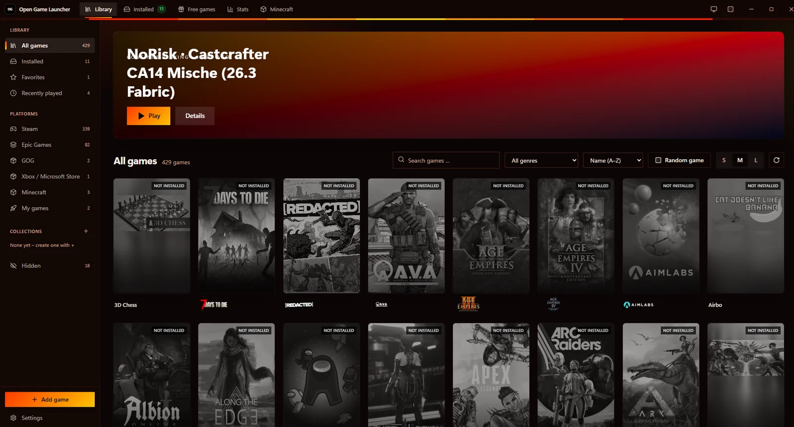
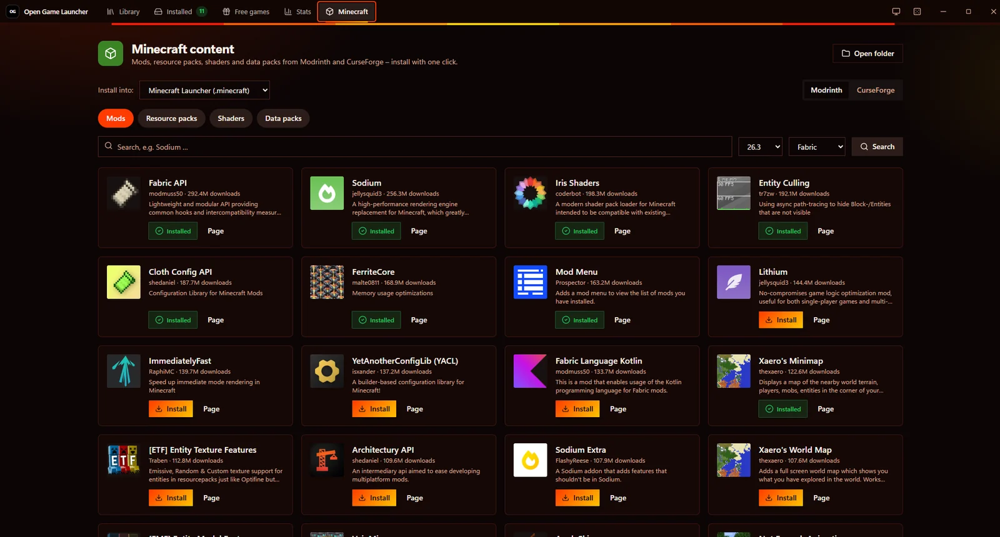

<div align="center">


# Open Game Launcher

**すべてのゲームを、ひとつのランチャーで。**

Steam、Epic Games、そして自分で追加したゲームを、高速・軽量・美しい Windows アプリにまとめました。100% Rust 製です。

[](https://github.com/MikeAdamRGB/Open-Game-Launcher/releases/latest)
[](https://github.com/MikeAdamRGB/Open-Game-Launcher/releases)
[](https://github.com/MikeAdamRGB/Open-Game-Launcher/actions/workflows/build.yml)


[](../../LICENSE)

[English](../../README.md) · [Deutsch](README.de.md) · [Français](README.fr.md) · [Español](README.es.md) · [Italiano](README.it.md) · [Português](README.pt-BR.md) · [Polski](README.pl.md) · [Türkçe](README.tr.md) · [Русский](README.ru.md) · **日本語** · [한국어](README.ko.md) · [简体中文](README.zh-CN.md)

[**⬇️ Windows 版をダウンロード**](https://github.com/MikeAdamRGB/Open-Game-Launcher/releases/latest)

<br>



</div>

---

> [!NOTE]
> 現在、アプリの画面表示は**ドイツ語**のみです。以下で引用しているボタン名(例: **「Spiel hinzufügen」**)はアプリ上の表記どおりで、訳を併記しています。

## 主な機能

| | |
|---|---|
| 🎮 **Steam** | すべてのドライブからインストール済みの Steam ゲームを自動検出します。Steam Web API キー(任意)を設定すると、プレイ時間を含めて所有している**すべての**ゲームを表示できます。 |
| 🟦 **Epic Games** | インストール済みの Epic ゲームを自動検出します。 |
| 🚀 **自分のゲーム** | `.exe`、ショートカット、バッチファイルなど、どんなゲームでも追加できます。起動前には**毎回**チェックリストで *「大事なものはすべてオフにした?」* と確認し、**いいえ** を選ぶとゲームは起動しません。 |
| 🖼️ **オリジナルのアイコンとカバー** | EXE や Steam から取得した本物のアイコンと公式カバー画像を表示。ゲームごとに独自のカバーも設定できます。 |
| 🎨 **3 種類のレイアウト** | **Steam ライブラリ風**、**Epic Games 風**、またはオリジナルの **OG スタイル**。 |
| 🌈 **8 つのカラーテーマ** | OG バイオレット、ミッドナイト、ネオン、エンバー、フォレスト、サクラ、OLED ブラック、ライト。アクセントカラーも自由に設定可能。 |
| 🛟 **わかりやすいエラー説明** | 起動できないときは、何が起きたのか、どう直せばよいのかを**ステップごとに**説明。*管理者として実行* や *Visual C++ をダウンロード* など、その場で解決できるボタンも表示します。 |
| 📦 **インストーラー内蔵** | EXE ひとつだけ。ダブルクリックするとインストールメニューが開き、デスクトップのショートカット、スタートメニューへの登録、*今すぐ開く*、*アプリフォルダーを開く* が選べます。管理者権限は不要です。 |
| 🪶 **超軽量** | サイズを最適化した単一の EXE。追加ファイルはありません。 |

## スクリーンショット

<table>
  <tr>
    <td width="50%" align="center">
      <br>
      <sub><b>ライブラリ</b>：すべてのゲームを一か所に</sub>
    </td>
    <td width="50%" align="center">
      <br>
      <sub><b>ゲーム詳細</b>：トレーラー、情報、実績</sub>
    </td>
  </tr>
  <tr>
    <td width="50%" align="center">
      <br>
      <sub><b>Minecraft</b>：ワンクリックで Mod</sub>
    </td>
    <td width="50%" align="center">
      <br>
      <sub><b>デザイン</b>：20 種類のデザインと自作デザイン</sub>
    </td>
  </tr>
</table>

## インストール

**動作環境:** Windows 10 / 11(64 ビット)と [Microsoft WebView2](https://developer.microsoft.com/microsoft-edge/webview2/)(最近の Windows にはプリインストール済み)。

1. [**Releases**](https://github.com/MikeAdamRGB/Open-Game-Launcher/releases/latest) から最新の **`Open-Game-Launcher.exe`** をダウンロードします。
2. ファイルを**ダブルクリック**します。
3. インストールメニューで **「Installieren」**(*インストール*)をクリックします。
4. 完了です。**「Jetzt öffnen」**(*今すぐ開く*)をクリックしてください。以降はデスクトップのショートカットから起動できます。

> [!TIP]
> **「Windows によって PC が保護されました」と表示された場合**
> 有料のコード署名証明書がない新しいプログラムで表示されます。**詳細情報** → **実行** をクリックしてください。

> [!TIP]
> **ポータブル版として使いたい場合** はインストールメニューで **「Ohne Installation starten」**(*インストールせずに起動*)をクリックするか、EXE と同じフォルダーに空の `portable.txt` を置いてください。


**アンインストール:** Windows の設定 → アプリ → 「Open Game Launcher」 → アンインストール、またはランチャーの **Einstellungen → Allgemein**(*設定 → 一般*)から。ゲーム自体は削除されません。

## 使い方

- **プレイ:** ゲームにマウスを重ねて ▶ をクリック。カバーをクリックすると詳細が開きます。
- **自分のゲームを追加:** 左側の **「Spiel hinzufügen」**(*ゲームを追加*) → 「Programm」の **「Durchsuchen…」**(*参照…*) → ゲームの実行ファイルを選択 → **「Hinzufügen」**(*追加*)。
- **見た目を変更:** **Einstellungen → Design** → レイアウト(OG / Steam / Epic)とカラーテーマを選択。
- **未インストールを含むすべての Steam ゲームを表示:** **Einstellungen → Verbindungen**(*接続*) → 無料の Steam Web API キーを入力。手順はすぐ横に表示されます。
- **チェックリストを編集:** **Einstellungen → Eigene Spiele**(*自分のゲーム*) → 項目を追加・編集・削除。ゲームごとの項目も設定できます。

### ランチャーが自動で説明するエラー

ゲームファイルが見つからない · ドライブ / USB ディスクが未接続 · 管理者権限が必要 · アクセス拒否 · 間違ったファイルを選択 · ウイルス対策ソフトによるブロック · Windows / Smart App Control によるブロック · ファイルが使用中 · DLL の不足(Visual C++ / DirectX) · エラー **0xc000007b** · **0xc0000142** · 起動直後のクラッシュ · Steam / Epic が未インストール · Steam / Epic が応答しない · Steam API キーが無効 · WebView2 がない · インストール失敗。

## ソースからビルド

**必要なもの:** Windows 上の [Rust](https://rustup.rs)(stable、1.85 以降)。それ以外は不要です(Node.js や Dioxus CLI も不要)。

```powershell
git clone https://github.com/MikeAdamRGB/Open-Game-Launcher.git
cd MAZ-Lauchner
cargo run                 # 開発用ビルド
cargo build --release     # リリース用 EXE: target\release\Open-Game-Launcher.exe
.\scripts\build.ps1 -Mini # EXE を dist\ にコピーし、UPX で圧縮した mini 版も作成
```

コンパイル済みの CSS(`assets/maz.css`)はリポジトリに含まれています。Tailwind のクラスを変更した場合は `.\scripts\build-css.ps1` を実行してください。

技術的な詳細(技術スタック、プロジェクト構成、サイズ最適化)は [英語版 README](../../README.md#tech-stack) をご覧ください。

## よくある質問

**ゲームをダウンロードしたり、コピープロテクトを回避したりしますか?**
いいえ。Steam と Epic のゲームは常に公式ランチャー経由で起動します。パスワードを求めることはありません。

**Epic のゲームがすべて表示されないのはなぜ?**
Epic はログイン後でないと購入済みゲームの一覧を提供しません。Open Game Launcher は**インストール済み**の Epic ゲームをすべて表示します。

**ウィンドウが真っ白のまま / 起動しない。**
Microsoft WebView2 が必要です(通常は Windows 10 / 11 に含まれています)。見つからない場合は、起動時にインストール方法を案内します。

**データはどこかに送信されますか?**
アカウントもテレメトリもありません。ネットワークはカバー画像の取得と、キーを設定した場合の Steam Web API にのみ使われます。

## コントリビュート

バグ報告、アイデア、プルリクエストを歓迎します: [Issue を作成](https://github.com/MikeAdamRGB/Open-Game-Launcher/issues/new/choose) · [CONTRIBUTING.md](../../CONTRIBUTING.md)


## 拡張機能と Minecraft

**Minecraft と NoRisk Client:** 公式 Minecraft Launcher と NoRisk の各プロファイルがそれぞれタイルとして表示されます。「Minecraft」タブから Modrinth と CurseForge の Mod、リソースパック、シェーダー、データパックをインストールできます。

**拡張機能**(初期設定はオフ):新しいゲームソース、情報、ボタンを追加する小さな外部プログラムです。インストール前にすべての権限とチェックサムが表示されます。正直な注意:拡張機能はあなたのユーザー権限で動作するため、信頼できるものだけを入れてください。詳細:[docs/EXTENSIONS.md](../EXTENSIONS.md)。

## ライセンス

[MIT ライセンス](../../LICENSE) © MikeAdamRGB

コンポーネントデザインは [rust-ui](https://github.com/rust-ui/ui)(MIT)を参考にしています。
Steam は Valve Corporation の商標です。Epic Games は Epic Games, Inc. の商標です。本プロジェクトは独立したものであり、両社とは一切関係ありません。
