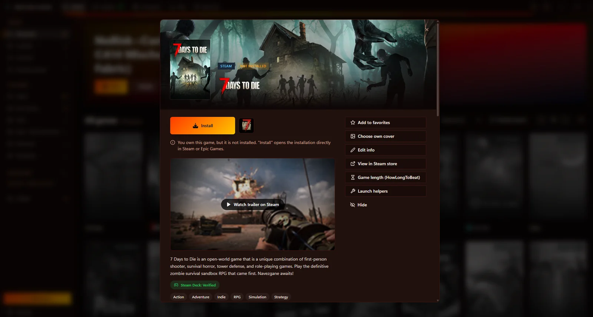
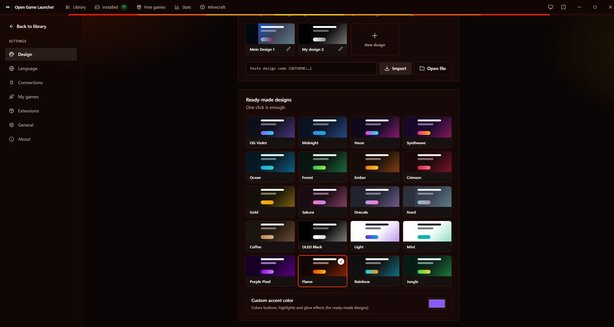

<div align="center">


# MAZ Launcher

**모든 게임을, 하나의 런처로.**

Steam, Epic Games 그리고 직접 추가한 게임을 빠르고 가볍고 보기 좋은 Windows 앱 하나에. 100% Rust로 만들었습니다.

[](https://github.com/MikeAdamRGB/MAZ-Lauchner/releases/latest)
[](https://github.com/MikeAdamRGB/MAZ-Lauchner/releases)
[](https://github.com/MikeAdamRGB/MAZ-Lauchner/actions/workflows/build.yml)


[](../../LICENSE)

[English](../../README.md) · [Deutsch](README.de.md) · [Français](README.fr.md) · [Español](README.es.md) · [Italiano](README.it.md) · [Português](README.pt-BR.md) · [Polski](README.pl.md) · [Türkçe](README.tr.md) · [Русский](README.ru.md) · [日本語](README.ja.md) · **한국어** · [简体中文](README.zh-CN.md)

[**⬇️ Windows용 다운로드**](https://github.com/MikeAdamRGB/MAZ-Lauchner/releases/latest)

<br>


</div>

---

> [!NOTE]
> 현재 앱 화면은 **독일어**로 제공됩니다. 아래에 인용한 버튼 이름(예: **„Spiel hinzufügen“**)은 앱에 표시되는 그대로이며 번역을 함께 적었습니다.

## 주요 기능

| | |
|---|---|
| 🎮 **Steam** | 모든 드라이브에서 설치된 Steam 게임을 자동으로 찾습니다. Steam Web API 키(선택)를 넣으면 플레이 시간을 포함해 보유한 **모든** 게임을 보여 줍니다. |
| 🟦 **Epic Games** | 설치된 Epic 게임을 자동으로 찾습니다. |
| 🚀 **내 게임** | `.exe`, 바로 가기, 배치 파일 등 어떤 게임이든 추가할 수 있습니다. **매번** 실행 전에 체크리스트가 *“중요한 건 모두 껐나요?”* 라고 묻고, **아니요**를 고르면 게임이 실행되지 않습니다. |
| 🖼️ **원본 아이콘과 커버** | EXE 또는 Steam에서 가져온 실제 아이콘과 공식 커버 이미지. 게임마다 원하는 커버를 지정할 수 있습니다. |
| 🎨 **3가지 레이아웃** | **Steam 라이브러리처럼**, **Epic Games처럼**, 또는 런처 고유의 **MAZ 스타일**로. |
| 🌈 **8가지 색상 테마** | MAZ 바이올렛, 미드나잇, 네온, 엠버, 포레스트, 사쿠라, OLED 블랙, 라이트. 강조 색상도 직접 고를 수 있습니다. |
| 🛟 **쉬운 오류 설명** | 실행이 안 되면 무슨 일이 있었는지, 어떻게 고치는지 **단계별로** 알려 주고, *관리자 권한으로 실행*이나 *Visual C++ 다운로드* 같은 바로 해결 버튼도 제공합니다. |
| 📦 **설치 프로그램 내장** | EXE 하나로 끝. 더블클릭하면 바탕 화면 바로 가기, 시작 메뉴 등록, *지금 열기*, *앱 폴더 열기*가 있는 설치 메뉴가 열립니다. 관리자 권한이 필요 없습니다. |
| 🪶 **초경량** | 크기에 최적화된 EXE 하나뿐, 추가 파일이 없습니다. |

## 스크린샷

<table>
  <tr>
    <td width="50%" align="center">
      <br>
      <sub><b>Steam 스타일</b>: 왼쪽 게임 목록, “최근 플레이”와 전체 게임 그리드</sub>
    </td>
    <td width="50%" align="center">
      <br>
      <sub><b>Epic Games 스타일</b>: 큰 카드와 상단 필터</sub>
    </td>
  </tr>
  <tr>
    <td width="50%" align="center">
      <br>
      <sub><b>게임 상세</b>: 플레이, 즐겨찾기, 폴더 열기, 커버 변경</sub>
    </td>
    <td width="50%" align="center">
      <br>
      <sub><b>디자인 설정</b>: 3가지 레이아웃, 8가지 테마, 강조 색상</sub>
    </td>
  </tr>
</table>

## 설치

**요구 사항:** [Microsoft WebView2](https://developer.microsoft.com/microsoft-edge/webview2/)가 있는 Windows 10 또는 11(64비트). 최신 Windows에는 WebView2가 기본 포함되어 있습니다.

1. [**Releases**](https://github.com/MikeAdamRGB/MAZ-Lauchner/releases/latest)에서 최신 **`MAZ-Launcher.exe`**를 다운로드합니다.
2. 파일을 **더블클릭**합니다.
3. 설치 메뉴에서 **„Installieren“**(*설치*)을 클릭합니다.
4. 끝입니다! **„Jetzt öffnen“**(*지금 열기*)을 클릭하세요. 이후에는 바탕 화면 바로 가기로 실행하면 됩니다.

> [!TIP]
> **“Windows의 PC 보호” 창이 뜨나요?**
> 유료 코드 서명 인증서가 없는 새 프로그램에서 나타납니다. **추가 정보** → **실행**을 클릭하세요.

> [!TIP]
> **포터블로 쓰고 싶다면** 설치 메뉴에서 **„Ohne Installation starten“**(*설치 없이 실행*)을 클릭하거나, EXE 옆에 빈 `portable.txt` 파일을 두세요.

**`MAZ-Launcher-mini.exe`**는 같은 앱을 UPX로 압축한 버전입니다. 일부 백신이 압축된 EXE를 잘못 탐지할 수 있으니, 그럴 때는 일반 버전을 사용하세요.

**제거:** Windows 설정 → 앱 → “MAZ Launcher” → 제거, 또는 런처의 **Einstellungen → Allgemein**(*설정 → 일반*)에서. 게임은 그대로 유지됩니다.

## 사용법

- **플레이:** 게임 위에 마우스를 올리고 ▶을 클릭합니다. 커버를 클릭하면 상세 정보가 열립니다.
- **내 게임 추가:** 왼쪽의 **„Spiel hinzufügen“**(*게임 추가*) → “Programm” 옆 **„Durchsuchen…“**(*찾아보기…*) → 게임 실행 파일 선택 → **„Hinzufügen“**(*추가*).
- **모양 바꾸기:** **Einstellungen → Design** → 레이아웃(MAZ / Steam / Epic)과 색상 테마 선택.
- **설치하지 않은 게임까지 모든 Steam 게임 보기:** **Einstellungen → Verbindungen**(*연결*) → 무료 Steam Web API 키 입력. 방법은 바로 옆에 안내되어 있습니다.
- **체크리스트 수정:** **Einstellungen → Eigene Spiele**(*내 게임*) → 항목 추가·수정·삭제. 게임별 항목도 지정할 수 있습니다.

### 런처가 자동으로 설명하는 오류

게임 파일 없음 · 드라이브/USB 디스크 미연결 · 관리자 권한 필요 · 액세스 거부 · 잘못된 파일 선택 · 백신에 의해 차단 · Windows / Smart App Control에 의해 차단 · 파일 사용 중 · DLL 누락(Visual C++ / DirectX) · 오류 **0xc000007b** · **0xc0000142** · 실행 직후 충돌 · Steam 또는 Epic 미설치 · Steam 또는 Epic 응답 없음 · 잘못된 Steam API 키 · WebView2 없음 · 설치 실패.

## 소스에서 빌드

**요구 사항:** Windows의 [Rust](https://rustup.rs)(stable, 1.85 이상). 그 외에는 필요 없습니다(Node.js, Dioxus CLI 불필요).

```powershell
git clone https://github.com/MikeAdamRGB/MAZ-Lauchner.git
cd MAZ-Lauchner
cargo run                 # 개발 빌드
cargo build --release     # 릴리스 EXE: target\release\MAZ-Launcher.exe
.\scripts\build.ps1 -Mini # EXE를 dist\로 복사하고 UPX로 압축한 mini 버전도 생성
```

컴파일된 CSS(`assets/maz.css`)는 저장소에 포함되어 있습니다. Tailwind 클래스를 바꿨다면 `.\scripts\build-css.ps1`을 실행하세요.

기술적인 내용(기술 스택, 프로젝트 구조, 크기 최적화)은 [영어 README](../../README.md#tech-stack)를 참고하세요.

## 자주 묻는 질문

**런처가 게임을 다운로드하거나 복사 방지를 우회하나요?**
아니요. Steam과 Epic 게임은 항상 공식 런처를 통해 실행됩니다. 비밀번호를 묻지 않습니다.

**왜 Epic 게임이 전부 보이지 않나요?**
Epic은 로그인한 뒤에만 구매한 게임 목록을 제공합니다. MAZ Launcher는 **설치된** Epic 게임을 모두 보여 줍니다.

**창이 하얗게 멈추거나 열리지 않아요.**
런처에는 Microsoft WebView2가 필요합니다(보통 Windows 10/11에 포함). 없으면 시작할 때 설치 방법을 안내합니다.

**내 데이터가 어딘가로 전송되나요?**
계정도 텔레메트리도 없습니다. 네트워크는 커버 이미지와, 키를 넣은 경우 Steam Web API에만 사용됩니다.

## 기여하기

버그 제보, 아이디어, 풀 리퀘스트 모두 환영합니다: [이슈 열기](https://github.com/MikeAdamRGB/MAZ-Lauchner/issues/new/choose) · [CONTRIBUTING.md](../../CONTRIBUTING.md)


## 확장 기능과 Minecraft

**Minecraft와 NoRisk Client:** 공식 Minecraft Launcher와 NoRisk의 모든 프로필이 각각 타일로 표시됩니다. 「Minecraft」 탭에서 Modrinth와 CurseForge의 모드, 리소스 팩, 셰이더, 데이터 팩을 설치할 수 있습니다.

**확장 기능**(기본값: 꺼짐): 새로운 게임 소스, 정보, 버튼을 추가하는 작은 외부 프로그램입니다. 설치 전에 모든 권한과 체크섬을 보여 줍니다. 솔직한 안내: 확장 기능은 사용자 권한으로 실행되므로 신뢰할 수 있는 것만 설치하세요. 자세히: [docs/EXTENSIONS.md](../EXTENSIONS.md).

## 라이선스

[MIT 라이선스](../../LICENSE) © MikeAdamRGB

컴포넌트 디자인은 [rust-ui](https://github.com/rust-ui/ui)(MIT)에서 영감을 받았습니다.
Steam은 Valve Corporation의 상표이며, Epic Games는 Epic Games, Inc.의 상표입니다. 이 프로젝트는 독립 프로젝트이며 두 회사와 관련이 없습니다.
